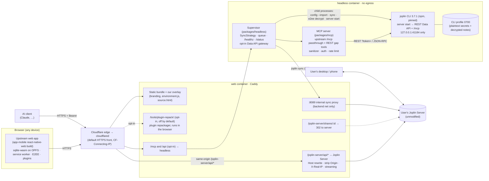
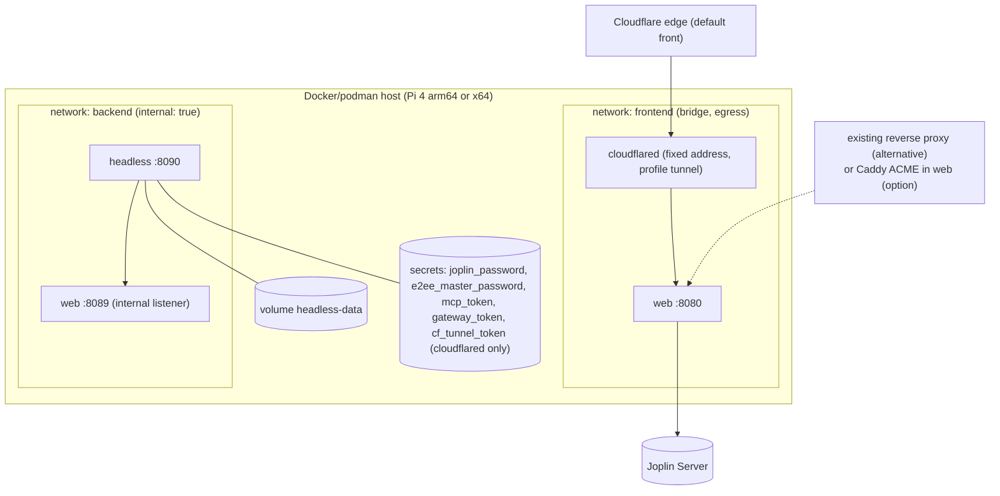

# Architecture: Notestead for Joplin (unofficial), a self-hosted web app, Data API and MCP stack

Status: **Approved** at gate 1 on 2026-10-04 (tag `plan-approved-v1`), with the gate 1 amendments applied the same day (§14: Cloudflare Tunnel front, the name Notestead, versioning rule D7, the user's versions). Proposed in Phase A / M0, 2026-10-03 (architect).

Upstream reference: laurent22/joplin `release-3.7` @ `e41516e66` (tag `v3.7.21`), npm `joplin@3.7.1` (`cli-v3.7.1` = `425a05ac4`), `joplin/server:3.7.2` (`server-v3.7.2`). Citations look like `upstream:<path>:<line>` and point into `~/joplin-web-app-work/upstream-joplin`.

---

## 1. Context, goals and non-goals

**Context.**
- The user runs a self-hosted **Joplin Server** with **E2EE enabled**, plus Joplin desktop and mobile clients (3.7.x).
- They want, on their own hardware (Raspberry Pi 4 arm64 today, x64 elsewhere):
  1. **Web UI:** the real Joplin UI in a browser, syncing with their existing server, with installable plugins.
  2. **Headless Data API:** the same REST Data API that the desktop app exposes, kept in sync and decrypted.
  3. **MCP server:** AI clients can manage notes, to-dos with alarms, notebooks and tags, reorganise them and trigger sync.
- **Public distribution** of the stack (images, an npm MCP package, the bundle) is also a goal, under the public name **Notestead** ("Notestead for Joplin (unofficial)"). The channels are chosen in `docs/delivery/channels.md` (approved at gate 1); artifact names are in ADR-0006.
- **The HTTPS front is Cloudflare Tunnel** (gate 1): `cloudflared` → the `web` container (ADR-0006, S6).

**Goals.**
- G1. Reuse upstream components through published or documented interfaces. **No fork.** Zero source patches today.
- G2. Stay correct as Joplin updates. Every upstream interface we consume has a test that detects drift (§6).
- G3. arm64 and x64 are first-class.
- G4. Never endanger the user's existing data or devices:
  - no `syncVersion` changes
  - no server-side changes
  - tests never touch the real server
- G5. Secure by default (§5): E2EE secrets, the Data API token, LLM-controlled input, the file:// exfiltration path.
- G6. Simple: two small containers, one compose file (plus the optional `cloudflared` container for the tunnel front).

**Non-goals.**
- Modifying or replacing Joplin Server, or hosting it.
- Joplin Cloud as a sync target.
- Re-implementing the Joplin UI or the Data API.
- Alarm notifications in the browser (an upstream limitation, L1).
- Background sync while no browser tab is open (L3). The headless service syncs independently.
- Running desktop-only plugins as they are. The opt-in repackager (ADR-0011) makes the ones that only lack the `mobile` tag or use menus runnable; plugins that need Node, Electron or native modules never run on web (L2).

## 2. Components



| Component | What it is | Ours or upstream | ADR |
|---|---|---|---|
| Web UI | `packages/app-mobile` `yarn web` output, unmodified, plus a static overlay | upstream (built by us from the pinned commit) | 0001, 0010 |
| `web` container | Caddy: static files, same-origin proxy, internal sync proxy, opt-in `/mcp` and `/api` routes | ours (config only) | 0002, 0006 |
| `headless` container | Node supervisor running the pinned CLI through public commands | ours (supervisor) + upstream (CLI) | 0003 |
| MCP server | `@modelcontextprotocol/sdk` server. Passes allow-listed upstream `/mcp` tools through, and adds REST gap tools. | ours + upstream tools | 0004 |
| Data API client | typed client for the documented REST API, with guards | ours | 0004, 0008 |
| Plugin repackager (opt-in, `PLUGIN_REPACKAGER=on`) | A static page in `web` that rewrites a user-supplied `.jpl` in the browser (manifest `platforms` += `mobile`; optional menu prelude) for upstream's "Install from file". Never uploads or redistributes plugins. | ours (`packages/plugin-repack`) | 0011 |
| `cloudflared` (optional, compose profile `tunnel`) | Cloudflare's official tunnel connector, pinned by digest; the default HTTPS front | third party (not Joplin) | 0006, 0008 |

## 3. Deployment topology (x64 and arm64)

The same compose file runs on both architectures. The images are multi-arch manifests. Both images are built natively per architecture. The web bundle inside the `web` image is **architecture-neutral** and built once on x64 (ADR-0001; S1).



- **Only `web` publishes a port** (default `127.0.0.1:8080`; with the tunnel, only for local use). Only `web` and `cloudflared` have egress, and `cloudflared` has no route to `backend`.
- **`headless` sits on an `internal` network.** Its only route out is `web:8089`, which forwards only `/joplin-server/api/*` to the configured server (ADR-0006).
- **No pod:** a shared localhost would expose the CLI's `127.0.0.1:41184` to `web`.
- **TLS (gate 1): Cloudflare Tunnel by default.** `cloudflared` sits on `frontend` at a fixed address and routes the public hostname to `web:8080`; `web` trusts `CF-Connecting-IP` only from that address. The existing reverse proxy is the documented alternative, and Caddy ACME an option. For use on a single machine, `http://127.0.0.1:8080` is a secure context and needs no TLS. A private CA is unsupported (phones).
- **`JOPLIN_SERVER_URL` is a direct address** of the user's server (LAN or container network), never a Cloudflare-proxied hostname (ADR-0002).
- **Resources measured on the Pi:**
  - `web` (Caddy) ~12 MB RSS
  - `headless` 84–109 MB for the container (the CLI `server start` process is 134–165 MB RSS), with brief single-core peaks during sync and decrypt (S3)
  - throwaway `joplin/server` (tests only) 213 MB
- **Image builds:** native per architecture in CI (ci-cd-specialist). The bundle is built once on x64.
  - Native on the Pi: the install phase alone took 33.6 min, with a 7.0 GiB peak system memory and 2 GiB of swap fully used. The webpack phase added 8.6 min with a 3.9 GiB RSS peak, and the clone plus `node_modules` used ~13 GB of disk (S1).
  - Local Pi builds are therefore a fallback, not the release path.

## 4. Data and sync flows (including E2EE)

**Browser.**
1. The user opens `https://<host>/` (Cloudflare edge → cloudflared → `web`), and the service worker installs (COOP/COEP pass through Cloudflare unchanged, S6).
2. The user picks the "Joplin Server" sync target with URL `https://<host>/joplin-server` and their credentials.
3. Upstream's sync client calls `/joplin-server/api/*`. Caddy forwards to the server with the Host rewritten (S2 C1–C3).
4. Items arrive encrypted. The app asks for the master password and decrypts them in the browser (WebCrypto).
   - *Amended 2026-10-21 (M2-S1 F5):* on a fresh web profile the order is the reverse. The app reads the master keys from `info.json` and asks for the master password, but its first sync aborts while uploading its welcome notes and downloads nothing. Items arrive (encrypted, then decrypted) only after the password is entered (L18).
5. Plaintext lives only in OPFS on that device.
6. Local edits are encrypted before upload.
7. Sync runs only while the tab is open.

**Headless sync cycle (stop-the-world, ADR-0003).**

```mermaid
sequenceDiagram
  autonumber
  participant T as Trigger (timer / write debounce / sync_now)
  participant S as Supervisor
  participant C as joplin CLI (child)
  participant W as web :8089
  participant J as Joplin Server
  T->>S: requestSync()
  S->>S: take mutex, queue new API calls, drain in-flight
  S->>C: SIGTERM "server start"
  S->>C: joplin sync
  C->>W: /joplin-server/api/* (encrypted items)
  W->>J: Host rewritten
  S->>C: joplin e2ee decrypt --force  (uses encryption.masterPassword)
  S->>C: config --import {api.token: fresh}; server start --quiet
  C-->>S: /ping OK (search index refreshed at startup)
  S->>S: release queue
```

The measured outage per cycle on the Pi is **~16–19 s** for small deltas: three CLI starts at ~4.5 s each, plus sync and decrypt. Search becomes fresh ~10 s after the restart. Requests that arrive during a cycle are queued (S3).

**MCP write → user's devices.**
1. The AI client calls `create_todo` (title, due date, notebook, tag).
2. The MCP server sanitizes the body and calls REST: `POST /notes` with metadata only, `PUT` with the body, then the tags.
3. The CLI encrypts the item at the next sync (E2EE is on for the account; S3).
4. The supervisor debounces a cycle (30 s).
5. The item reaches the server, encrypted.
6. The user's desktop or phone syncs, decrypts, and **schedules the alarm locally**. Alarms are per device and not synced. The web app never fires them (L1).

**Device write → MCP read.**
1. The device syncs to the server.
2. The next headless cycle (timer, or `sync_now`) syncs, decrypts and restarts the API (which refreshes the search index).
3. `read_note` and `search_notes` see the change.

**Integrity rules.**
- No automation runs `sync --upgrade`.
- The supervisor refuses a CLI whose `syncVersion` differs from the pin (3).
- Sync-target `info.json` version `3` is asserted unchanged in tests (S4 §B).

## 5. Security model (summary of ADR-0008)

| Threat | Control | Test |
|---|---|---|
| LLM-written `` makes `POST /notes` copy the profile DB (plaintext secrets) into a resource that syncs out (`upstream:packages/lib/services/rest/routes/notes.ts:518, 278-280`; reproduced in S4 M10) | Our code never sends bodies to `POST /notes` (metadata POST + `PUT` body). A body sanitizer rejects `file:`/`data:`/`http:`/`javascript:` targets. Attachments take content, never paths. The headless service has no egress except to the Joplin Server. The opt-in gateway rejects `file:` in `POST /notes`. | M4-AC7/8, M3-AC10/12 |
| Data API token leaks (query string; logged in full by `ClipperServer.ts:215` into `log-clipper.txt`, shown in S3) | The CLI port never leaves the container namespace. The token is rotated on every CLI start. `--quiet`, plus redaction of relayed lines, plus truncation of `log-clipper.txt`. External clients use separate MCP/gateway tokens. | M1-AC17, M3-AC8 |
| Secrets at rest (Linux: plaintext in the profile DB) | Secrets come from podman secrets, are piped through `config --import` on stdin (never argv or env), the volume is `0700` and non-root. Encrypted disk is recommended. A least-privilege bot account is offered as an option (Q8). | M1-AC14, M3-AC7 |
| Prompt injection → destructive actions | Trash by default. Permanent delete needs `MCP_ALLOW_PERMANENT_DELETE` and carries `destructiveHint`. Read-only mode. Rate limits. An audit log without content. | M4-AC9/10/17 |
| MCP endpoint exposure / DNS rebinding | Bearer token ≥ 32 bytes, `Origin` allow-list, TLS via the front, off the host by default | M4-AC2 |
| Proxy abuse / limiter bypass | Only `/joplin-server/api/*` is proxied. `X-Real-IP` is overwritten with the real client IP, taken from `CF-Connecting-IP` only when the peer is cloudflared, else from the TCP peer. Server UI is not re-published. | M1-AC10/11 (S2 R1–R4, S6 R5-neg) |
| TLS terminated by Cloudflare (gate 1) | Stated plainly (L17): Cloudflare sees the web login, session ids, the MCP bearer token and decrypted MCP results; sync payloads stay E2EE. `MCP_PUBLIC=false` keeps MCP host-local for users who don't accept it. Tunnel token from a podman secret; optional Access service token on `/mcp`; bearer token stays mandatory. | M5-AC13, M5-AC11 |
| Front caches or rewrites the app | `Cache-Control: no-cache, no-transform` on static files, `no-store, no-transform` on API/MCP; zone checklist (Rocket Loader, Bot Fight Mode, challenges off) | M1-AC10 C10, M1-AC12, M5-AC11 |
| User content on the app origin (XSS → OPFS secrets) | Published notes redirect to the server origin. The upstream CSP stays intact. The only other page on the origin is the opt-in plugin repackager (ADR-0011): off by default, a strict CSP with `connect-src 'none'`, plugin data rendered as text and never evaluated. | M2-AC14, M2-AC24/25/26 |
| A repacked plugin (untested on web) misuses or damages notes | Off by default; an acknowledgment per plugin with the risk statement; refusal of `child_process`/`electron`/native modules; the same sandboxed iframe and API as any plugin, with no new privilege; bug reports routed to us (ADR-0011) | M2-AC22/24/25 |
| Supply chain | Pinned commit, lockfile, image digests, SBOM, provenance, signing (ci-cd), `check:no-upstream-copy`, licence allow-list | M1-AC4, M5-AC4/5 |

## 6. Upstream reuse map

| # | Our component | Upstream artifact (pinned) | Interface consumed | Stability of that interface | What breaks on upgrade | Detection (test) |
|---|---|---|---|---|---|---|
| 1 | Web UI | app-mobile web build, `release-3.7` @ `e41516e66` (`v3.7.21`; app-mobile code identical to `android-v3.7.11`) | Official build recipe (`corepack yarn install`; `cd packages/app-mobile && yarn web`); `web/dist` layout; static files `environment.js`, `manifest.json`, `icons/*`, `index.html`, `just-one-client.html`, `closed.html` | **Medium-low.** The bundle isn't a published artifact and upstream doesn't test it, but the recipe has been stable in github.com/joplin/web-app. | New build steps or Node/yarn requirements; renamed static files (overlay); new header requirements | `web-bundle.yml` build; overlay expected-file check (M1-AC6, M6-AC5); M2 E2E suite |
| 2 | Browser ↔ server sync | Upstream sync client in the bundle (`lib/JoplinServerApi.ts`, `Synchronizer.ts`) | Joplin Server sync API under `api/*`, `X-API-AUTH`, `X-API-MIN-VERSION: 2.6.0` | **High.** Shared by every Joplin client. | A path outside `api/` (proxy 404s it); a change in the auth scheme | M2-AC1; proxy contract C1–C3 |
| 3 | Same-origin proxy | Joplin Server behaviour (any 3.x, unmodified) | Host-based `isValidOrigin`; hard-coded CORS; `X-Real-IP` trust in `userIp()`; `/shares/:id` route | **Medium.** Internal and undocumented, but long-standing. | Server starts honouring `X-Forwarded-Host` (harmless) or stops trusting `X-Real-IP` (limiter keying changes); share URL scheme changes | Proxy contract suite with negative controls C1-neg and R1–R4 (M1-AC10/11), M2-AC14 |
| 4 | Headless runtime | npm `joplin@3.7.1`, lockfile-pinned `@joplin/lib`/`renderer`/`utils` 3.7.1 | CLI commands `config --import`, `sync`, `e2ee decrypt --force`, `server start --quiet`, `version`; files `clipper-pid.txt`, `settings.json`, `log-clipper.txt` | **Medium.** The commands are documented (`joplin help`), but `server` is labelled experimental. | Flags or commands change; startup cost; log format (redaction) | Headless contract suite M3-AC3–16; integration M1-AC14–17 |
| 5 | Headless configuration | `@joplin/lib` settings metadata | `sync.target`, `sync.9.path/username/password`, `encryption.masterPassword`, `api.token`, `api.port`, `mcp.enabled`, `ai.tool.<id>.enabled` | **Medium.** `sync.*` has been stable for years. `mcp.*`/`ai.*` are new in 3.7 (beta). | Renamed or removed keys | M1-AC14, M3-AC16, M4-AC3 |
| 6 | REST Data API (MCP gap tools, gateway) | `ClipperServer` + `Api` inside the CLI | Documented routes (`upstream:readme/api/references/rest_api.md`): `/notes`, `/folders`, `/tags`, `/resources`, `/search`, `/revisions`, `/ping` | **High.** Documented, and used by the web clipper and plugins. | Field or route changes, pagination | `rest-shape` snapshots (M6-AC3); M3-AC11; M4 contract |
| 7 | MCP passthrough | Upstream `/mcp` (3.7, beta), `McpServer.ts`, `ToolIndex.ts` | JSON-RPC `initialize`/`tools/list`/`tools/call`; tool names and input schemas | **Low.** Beta, all off by default, the spec and code disagree on defaults. | Tool renames or schema changes; settings keys | `mcp-upstream` snapshot (M4-AC4); automatic REST fallback |
| 8 | Version safety | `syncVersion: 3` (`upstream:packages/lib/models/Setting.ts:306`) | constant | **High, and critical.** | A bump upgrades the user's sync target and locks older devices out | `check:pin`; M3-AC9; M6-AC2 |
| 9 | Test server | `docker.io/joplin/server:3.7.2` | `node dist/index.js --env dev --env-file /dev/null`; `POST /api/debug` (`createTestUsers`, `clearDatabase`); `GET /api/ping`; `JOPLIN_IS_TESTING` | **Medium-low.** Test hooks, undocumented; the image CMD ignores `APP_ENV` (S2). | The harness can't seed | Harness self-tests M1-AC18–20 |
| 10 | Plugins on web | Plugin API inside the bundle; plugin repo `github.com/joplin/plugins` | `.jpl` format and install from file; the platform gate (`platforms` must include `mobile`, else Incompatible and never run); `noteToolbar`/`editorToolbar` rendering; direct browser fetches of the repository (L2) | **Medium** | Web plugin API gaps change; the gate or the repository mirrors change | M2-AC9/10 (NEG 2: a desktop-only plugin installs, is Incompatible and never runs) |
| 11 | HTTPS front (third party, not Joplin) | `docker.io/cloudflare/cloudflared` (2026.9.3 at S6), pinned by digest, plus Cloudflare's edge | `CF-Connecting-IP`; plan body limits (Free/Pro 100 MB); 524 after 125 s; zone defaults (caching by extension, Email Obfuscation) | **Medium.** Documented, but limits and defaults change on Cloudflare's schedule. | Limits/timeouts tighten; a new default transformation | M1-AC11/12 (our side of the contract); M5-AC11 zone checklist on the real tunnel |
| 12 | Plugin repackager (ADR-0011, opt-in) | `.jpl` format; the plugin gate in `@joplin/lib` (pinned); app-mobile's plugin runner in the bundle | `manifest.json` fields `platforms`/`app_min_version`/`id` and the parser's tolerance of an extra field (`upstream:packages/lib/services/plugins/utils/manifestFromObject.ts:55-79`, `…/isCompatible/index.ts:10-13`); install from file replacing by id; **internals (phase 1b):** the plugin script runs after `window.joplin` is set, and the global is replaceable (`…/backgroundPage/startStopPlugin.ts:57-66`, `…/initializePluginBackgroundIframe.ts:12`); the service worker's cache fallback for non-OK responses (`upstream:packages/app-mobile/web/serviceWorker.ts:180-187`) | **Low** (the `.jpl` format and gate are stable but undocumented; the phase 1b assumptions are internals) | A new gate input (for example signatures) makes repacks Incompatible; the prelude's assumptions change (the prelude then switches itself off); the service worker changes how it caches | Repack contract with the pinned `@joplin/lib` (M2-AC23), canary prelude contract (M2-AC31), M2-S12 E2E, `@network` nightly (M2-AC32) |

## 7. Version skew, upgrade and rollback (summary of ADR-0005)

- **One pin file** (`upstream/joplin-version.json`): web commit and tag, CLI version, server test tag, `minor`, `syncVersion`. `yarn.lock` pins the CLI's transitive `@joplin/*`.
- **Skew:**
  - All artifacts stay on the **same minor** as the user's server and clients (3.7).
  - Patches may differ (web 3.7.21 vs CLI 3.7.1 is allowed).
  - `syncVersion` must be equal everywhere (3).
- **Upgrades:**
  - Patch bumps come as automated PRs gated by the full suite on both architectures (M6).
  - A minor bump happens only after the user confirms that their server and clients are on that minor, with an ADR amendment.
  - **Our version (D7, gate 1):** one lockstep semver for all artifacts. An upstream patch is our PATCH; a Joplin minor upgrade is our **MAJOR** (MINOR while 0.x) and moves the floating `joplin<minor>` image tag (ADR-0006).
- **Rollback:**
  - Image digests are immutable. The headless profile is snapshotted before a CLI version change (last 3 kept).
  - The browser database migrates forward only: roll back, then "clear site data" and re-sync. Unsynced local edits, local E2EE password entry and plugins are lost. The user's runbook is `deploy/web/README.md`, "Rolling back the web app" (M2-S5).
  - After an upgrade that changes the service worker, a tab may need one manual reload (L22).
  - The user's server is never touched.

## 8. Test strategy (summary of ADR-0007)
- **Unit:** Jest, mock Data API module, fake timers.
- **Integration:** a real CLI child process on a temp profile.
- **Contract:** a throwaway `joplin/server` container ↔ `web` proxy ↔ `headless` ↔ MCP, with snapshots of REST shapes and the upstream `tools/list`.
- **E2E:** Playwright in Chromium against the `web` container, with a fresh context and OPFS per test and data assertions through REST/MCP.
- **Everywhere:** negative controls, `expect.poll`, no sleeps, logs attached.
- **Where it runs:** Pi with 1 worker; CI on `ubuntu-24.04` and `ubuntu-24.04-arm`.

## 9. Known limitations (stated plainly)

- **L1.** The web app never fires **alarm notifications**. `AlarmServiceDriver.web.ts` is a no-op. Due dates are stored and synced, and alarms fire on your desktop or phone after they sync.
- **L2.** **Plugins on web** *(corrected 2026-11-19 from M2-S4's findings P2, P4, P5 and P7, and the PLUGINS-WEB study)*:
  - **Desktop-only plugins install but never run.** "Install from file" accepts any `.jpl`. A plugin whose manifest doesn't list `mobile` (or has no `platforms` field and isn't on upstream's short allow-list) shows **Incompatible** and is never started (`upstream:packages/lib/services/plugins/PluginService.ts:626-631`, `:678-713`). In the repository search, such plugins are listed but their Install button is disabled. That is 287 of the 411 plugins in the official repository (2026-11-19). There is no upstream switch to run them anyway; see [PLUGINS-WEB](../spikes/PLUGINS-WEB.md) for the options.
  - **Opt-in workaround (ADR-0011, story M2-S12, not built yet):** the plugin repackager page in `web`, off by default, changes your copy of a desktop-only plugin so it runs on web, and (phase 1b) shows its menu commands in the note action menu. You acknowledge the risk per plugin: a repacked plugin was never tested by its author on this platform, it has the same access to your decrypted notes as any plugin, and bug reports go to Notestead, not to the plugin author or Joplin. A repacked plugin gets no in-app updates; repack the new version. Plugins that need Node, Electron or native modules (backup tools, folder watchers, desktop themes) are refused and can never run on web.
  - **Menus are never shown.** Commands that a plugin puts in `views.menus`/`views.menuItems` (Tools menu, context menus) appear nowhere on web. `noteToolbar` buttons appear in the note's action menu, and `editorToolbar` buttons in the editor toolbar. Your repeating-todos plugin runs, and its "Open Recurrence Dialog" is in the note action menu, but its "Repeating Todos" menu is missing.
  - **Missing APIs on web:** `views.noteList`, `joplin.fs`, Node modules through `joplin.require` or `require` (only `path` exists), `joplin.imaging`, `dialogs.showOpenDialog`, `joplin.ai`, chrome CSS and HTML/image clipboard. Panels and dialogs work, but panels open in a viewer instead of docked beside the editor.
  - **Opening Configuration → Plugins contacts GitHub straight from your browser** (raw.githubusercontent.com, api.github.com). If GitHub doesn't answer, it tries up to four third-party mirrors (cdn.staticaly.com, ghproxy.com, cdn.jsdelivr.net, raw.fastgit.org). These requests don't pass through our proxy (`upstream:packages/lib/services/plugins/RepositoryApi.ts`). It is like L15. Avoid that screen if this matters to you; installing from file needs no network.
  - **Plugins are per browser profile.** Installed plugins and their settings live in that browser's storage. They don't sync to your other browsers or devices, and "clear site data" removes them.
- **L3.** **One tab per browser profile** (the second tab is redirected). The web app syncs **only while a tab is open**.
- **L4.** **Browser storage holds plaintext.** The browser's OPFS holds your decrypted notes, your sync password and the E2EE password state. Protect devices accordingly. "Clear site data" logs you out and deletes them.
- **L5.** **Web database upgrades are one-way.** Rolling back to an older web bundle requires clearing site data and re-syncing (runbook: `deploy/web/README.md`, "Rolling back the web app"). The re-synced browser is a fresh profile, so each recovery adds one or more further copies of upstream's welcome notebook to your account (L14); delete the extras afterwards. *(Amended 2026-11-23, M2-S5 F5/RU-8.)*
- **L6.** **Headless search lag.** Search sees notes created through REST/MCP only after the next headless sync cycle. The CLI doesn't index in command mode; a cycle follows writes within ~30 s.
- **L7.** **The headless API pauses during each sync cycle** (default every 5 min, plus ~30 s after AI writes). Requests wait rather than fail. Measured outage: ~16–19 s per cycle on the Pi (S3), i.e. ~5–6 % of the time at the default interval.
- **L8.** **No plugins in headless.** The headless CLI runs no plugins, OCR, semantic search, or revision creation. Revisions made on your devices are listed but can't be restored through MCP.
- **L9.** **Published-note links** created in the web app redirect to your server's public URL. They only work where that URL is reachable.
- **L10.** **Only self-hosted Joplin Server** is supported as the sync target of this deployment. Other upstream targets would need their own CORS proxies and are out of scope. Joplin Cloud is not supported.
- **L11.** **Browser support:**
  - Chromium-family browsers are the reference.
  - Safari (no COEP `credentialless`) runs in `require-corp` mode, where external images without CORP headers don't load.
  - Firefox is smoke-tested only.
  - A secure context (HTTPS, or `127.0.0.1` locally) is required.
- **L12.** **MCP restrictions:** remote images and links in AI-written bodies are refused by default, tag deletion and permanent deletes are off by default, and revision restore is unsupported.
- **L13.** **Upstream MCP is beta.** Its tools can change between patch releases. Snapshot tests make this visible, and the REST fallback keeps tool names stable.
- **L14.** **The first web login adds upstream's welcome notebook** ("0. About the web app" … "5. Joplin Privacy Policy") to your account (S4). Delete it if you don't want it. Upstream gives no option to skip it. **It happens again on every fresh browser profile**: a new browser, "clear site data", or a rollback recovery (L5). Each time, one or more copies are added; the count varies (one and two were observed after the same recovery in M2-S5, RU-8). A likely cause, not proven, is that the app starts twice on a fresh profile, because upstream reloads the page right after registering its first service worker (`upstream:packages/app-mobile/web/serviceWorker.ts:281-286`), and the second start creates the welcome items again before the first start has recorded them (`upstream:packages/lib/WelcomeUtils.ts`, called from `upstream:packages/app-mobile/utils/buildStartupTasks.ts:485-486`). Delete the extra welcome notebooks. On an E2EE account these notes also block the first sync until the master password is entered (L18).
- **L15.** **The web app checks connectivity against `https://joplinapp.org/connection_check/`.** It's an upstream behaviour (S4). Under cross-origin isolation the request fails harmlessly, but the attempt is visible to your network and possibly to joplinapp.org.
- **L16.** **Attachment size through Cloudflare.** Cloudflare's Free and Pro plans accept request bodies up to 100 MB (Business 200 MB). With E2EE, an attachment grows ≈ 1.34× when encrypted, so the **web app** can upload attachments up to ≈ 74 MB on Free/Pro. Larger ones show as "cannot sync" in the web app's sync status, and the rest of the sync continues. Desktop and mobile sync directly with your server and are unaffected; so is the headless service. **Note bodies grow more than attachments:** E2EE encrypts a note as UTF-16LE text and then base64 (`StringV1`, `upstream:packages/lib/services/e2ee/EncryptionService.ts:508-516`), which is ≈ 2.7× for ASCII text. So on Free/Pro, a note body of about 37 MB or more cannot sync from the web app (from the code, not measured). *(Note bodies added 2026-11-13, M2-S3 plan.)*
- **L17.** **Cloudflare sees your plaintext web traffic.** Cloudflare terminates TLS for the tunnel, so it can see the web login (your Joplin Server password), session ids, the MCP bearer token and the **decrypted notes that MCP returns**. Note content in sync stays end-to-end encrypted. If that's not acceptable for MCP, keep `MCP_PUBLIC=false` and use MCP only on the host, or use your own reverse proxy instead of the tunnel. *(2026-10-04: the user accepts this for their own deployment and publishes MCP through the tunnel behind Cloudflare Access plus the bearer token; the default stays `MCP_PUBLIC=false`. See §14, Q7.)*
- **L18.** **On the first web login to an E2EE account, the web app syncs nothing in either direction until you enter the master password.** Its first sync uploads the welcome notes it has just created (L14) before it downloads anything. It can't encrypt them without the master key (`Master key is not loaded`), and that error aborts the whole sync, so the download step never runs. The app still shows the decryption banner, because it reads the master keys from `info.json` first. Enter the master password right after logging in; the deploy guide will say so when it is written. This is upstream behaviour at v3.7.21 (`upstream:packages/lib/Synchronizer.ts:415` runs `update_remote` before `delta`; `upstream:packages/lib/services/e2ee/EncryptionService.ts:228` throws `masterKeyNotLoaded`, which `isCannotSyncError` (`Synchronizer.ts:66`) doesn't skip, so it reaches the outer `catch` at `:1205`). It's a candidate upstream issue the user may file (U13). Found in M2-S1 (F5, D1): [`docs/test-plans/M2-S1.md`](../test-plans/M2-S1.md), asserted by M2-AC2. *(Added 2026-10-21.)*
- **L19.** **Very large attachments in the web app.**
  - **Attaching:** the web app refuses a file of 200 MiB or more (`upstream:packages/app-mobile/components/screens/Note/Note.tsx:1018`). The server's per-upload cap and Cloudflare can be lower (ADR-0002 rule 5, L16).
  - **Downloading, without E2EE:** like the phone apps, the web app doesn't download an attachment of 100 MB (decimal) or more, and shows it as "cannot sync". The web build runs as `AppType.Mobile` (`upstream:packages/app-mobile/utils/buildStartupTasks.ts:178`), and `Synchronizer.maxResourceSize()` is 100 000 000 B for that type (`upstream:packages/lib/Synchronizer.ts:172-175`).
  - **Downloading, with E2EE (your case): the limit almost certainly never applies.** The check reads `size` from the server copy (`Synchronizer.ts:1077`). An encrypted server copy keeps only ids, timestamps and the cipher text (`upstream:packages/lib/models/BaseItem.ts:558-571`, `keepKeys`), so `size` is missing and the comparison is false. The web app then downloads the attachment whatever its size, although upstream's message for this limit warns that the mobile app "would crash" beyond it. Items that upstream leaves unencrypted on an E2EE account keep their `size`, so the limit still applies to them. These are published items, and items in a share that has no key of its own (`upstream:packages/lib/models/utils/itemCanBeEncrypted.ts`).
  - **Evidence:** this is from reading the code at v3.7.21, and no test covers it yet. M2-AC7a proves only that the web app uploads a 100 MiB attachment and that headless reads it back. It doesn't download it into a second web profile. QA's F1 in [`docs/test-plans/M2-S3.md`](../test-plans/M2-S3.md) stated the limit without the E2EE exception. *(Added 2026-11-13.)*
- **L20.** **Rarely, a web UI edit is silently lost: the app shows it, but it is never stored and never syncs.** The web app's own browser database (SQLite in OPFS) sometimes fails a single statement. What that means for you depends on where it fails:
  - **In the app's log database:** a log line is lost. Nothing else happens.
  - **While the app starts:** the app doesn't open (`Startup failure during task: buildStartupTasks/openDatabase`). A reload fixes it.
  - **Inside a multi-statement write, such as a settings save (`Could not save settings` in the browser console), while one of your edits is being saved:** the failed write is rolled back, and your edit is rolled back with it. The screen keeps showing the edited text, because it renders from memory. This needs both events at once. It has happened once in our runs (occurrence 2, a note-title edit, `docs/test-plans/DNS-1.md` "The finding"), and fault injection reproduces it every time. A failed read changes no stored data.

  If an edit is missing on your other devices, re-open the note in the web app and check it there. The headless Data API, MCP and the Joplin Server are unaffected: they don't use the browser database. Investigation: [`docs/worklog/WEB-SQLITE-1.md`](../worklog/WEB-SQLITE-1.md). *(Added 2026-11-11; user decision 2026-10-25. Amended 2026-11-13: the single-browser rate, the user-facing effects and the test-run policy.)*
  - **Proven mechanism, upstream at v3.7.21: two defects.**
    - `upstream:packages/lib/database.ts:210-235` (`transactionExecBatch`) takes the batch mutex only for batches of two or more queries. Single-query saves, such as a note title `UPDATE` from `BaseModel.save` (`BaseModel.ts:690`), plus `exec`, `selectOne` and `selectAll`, run without it. The web driver has one connection (`upstream:packages/app-mobile/utils/database-driver-react-native.web.ts:19-31`), so those statements run inside another caller's open `BEGIN … COMMIT`. The batch's `ROLLBACK` then undoes them too.
    - `tryCall` (`database.ts:159-160`) retries only on `error.code` `SQLITE_IOERR` or `SQLITE_BUSY`. The web driver's errors carry no `code` (`database-driver-react-native.web.ts:42`), so a transient failure is never retried on web.
    - The loss is reproduced deterministically by injecting a failing statement into a settings batch (worklog §4).
  - **Unproven trigger:** sqlite-wasm's `opfs` VFS returns `sqlite3_step() rc= -1` (the VFS's "no result yet" value, not a SQLite code) or `rc= 10` (`SQLITE_IOERR`), with no `OPFS syncer … async error` line. Everything below was measured on the Pi (arm64):
    - **Several browsers starting the app at once:** about 1.3 % of startups (3 in about 230; the SE's reproduction, worklog §3).
    - **One browser, bare startup, no stack running:** 0 in 170 (worklog §3).
    - **One browser, an E2E-like flow (sync and E2EE decrypt into OPFS, then edits), with the stack's containers up:** 2 of 76 starts (2.6 %, 95 % Wilson interval 0.7 % to 9.1 %), or 3 of 79 counting the pilot runs. The one fatal occurrence was a pilot run: `rc 10` on a startup `ALTER TABLE` migration, then the `openDatabase` startup failure. The other two were `INSERT INTO logs` in the log database, and the app carried on. A busy stack (the headless service restarted back to back) and an idle one hit it at the same rate, 1 of 46 against 1 of 30 (worklog §11, `b6b9916`).
    - **M2-S3's local E2E runs, one browser, the stack up (occurrences 4 to 6):** `rc -1` on a read (`SELECT` of the shared folders), `rc -1` on a startup `COMMIT` followed by the `openDatabase` startup failure, and `rc 10` on a read (`SELECT count(*) FROM resources`). See [`docs/test-plans/M2-S3.md`](../test-plans/M2-S3.md), "L20 occurrences, local runs".
    - **So far:** it hits both databases, reads and writes, and startup. It does not need several browsers. No undone edit (shape A) occurred in the rate measurement or in occurrences 4 to 6; occurrence 2 is the one real case. **x64 is not measured yet**, and nothing so far shows the defect is specific to arm64.
    - **The root cause inside the VFS is a hypothesis.** Two candidates remain open: CPU contention inside the browser (its own decrypt and sync work against the OPFS async proxy), or heavier OPFS traffic. Nothing we own selects another VFS (`vfs=opfs` is hard-coded in the bundle), so no deploy-level mitigation exists.
  - **Detection:**
    - **WS-1:** every E2E test fails at teardown on a qualifying SQLite failure in its own browser console, and names it value-free.
    - **WS-3:** after each UI edit, a check that the web app's own OPFS database file holds the new value (`expectStoredLocally`), so a lost save and a lost sync are different failures.
    - **`WSQ-01`** (`tests/e2e/harness/web-sqlite-scope.spec.ts`) asserts today's behaviour with the fault injected, and turns red when upstream fixes the transaction scope.
    - Plan: [`docs/test-plans/M2-S3.md`](../test-plans/M2-S3.md) R1, D-W1 to D-W3. The qualifying conditions of the tie are in [`docs/test-plans/DNS-1.md`](../test-plans/DNS-1.md) §T, as re-scoped by the M2-S3 plan's local rule.
  - **Test-run policy: the L20 tie (user decision 2026-11-13; replaces the arm64-only, M2-S3-only tie of 2026-10-25):**
    - **What qualifies is unchanged:** only `rc= -1` or `rc= 10` lines (not 0 or 1, not the spellfix line), shape A, B or a WS-1-only failure, WS-2's `web-sqlite.json` attached, and nothing else failing in that test.
    - **A qualifying failure is recorded as an L20 occurrence.** The run is **not** re-run to get green, and the failure stays visible (red or flaky) in the report.
    - **HARD STOP only at a third occurrence in one run** (a local run, or one arm64 runner's share of a CI run). At the measured rate, about 25 app starts per full run give at least two occurrences by chance in about 14 % of runs, and at least three in about 2.6 % (worklog §11.5).
    - **On x64, CI counts the occurrences and does not block on them,** so that the x64 rate becomes known.
    - **Every occurrence records** which database failed (main or log) and whether startup failed, next to the test, the `rc`, the statement kind and the evidence path.
    - **Duration:** the tie holds until upstream fixes L20 (U14), and is reviewed at each milestone close. It no longer expires at the M2-S3 merge.
    - **The tie governs test runs only.** For users, L20 stays a known limitation.
  - **Mitigation and status:**
    - **Upstream issues, filed by the user (U14):** A, the transaction scope, and B, mapping the web driver's errors to `code` so the retry applies. Drafts are in the worklog §6; the links get added here when they are filed. A sqlite-wasm report for the `rc= -1` itself (C) waits for a smaller reproduction without Joplin. Draft C's "two or three browsers loading the app at once" is out of date: use the single-browser figures above (worklog §11).
    - **No local fix:** following "Reuse, never fork", there is no `patches/` file.
- **L21.** **The sync wizard shows upstream's Joplin Cloud logo.** The "Joplin Cloud" option in the web app's sync wizard carries upstream's logo (an inline SVG compiled into the app, `upstream:packages/app-mobile/components/SyncWizard/JoplinCloudIcon.tsx`), which our branding overlay can't replace without patching upstream. It labels the third-party sync option and is not Notestead's branding; Joplin Cloud itself is not supported here (L10). The trademark review before the first public release includes it. Documented by `M2-S6-LOGO-01`. *(Added 2026-11-21; the user's decision Q1 = (a) of 2026-11-20, ADR-0010 Consequences.)*
- **L22.** **After an upgrade, the tab can stay "loading" after its automatic reload. Reload the page once.** When an upgrade changes the web app's service worker (`serviceWorker.bundle.js`), upstream's page script reloads the page by itself (console: `Reloading page to make use of updated COOP/COEP Service Worker.`). Sometimes that automatic reload never finishes: the tab keeps its loading indicator and no request reaches the server. **The app is already running the new version, and your data is safe:** the page that started the reload has opened the profile and keeps syncing. One manual reload completes it. *(Added 2026-11-23, M2-S5.)*
  - **Cause (upstream plus Chromium, nothing of ours):** the page script reloads on the registration's `updatefound` event, that is while the new worker is still installing (`upstream:packages/app-mobile/web/serviceWorker.ts:275-279`), and the new worker calls `skipWaiting()` on install and `clients.claim()` on activate (`serviceWorker.ts:43-44`). The reload therefore races the activation. When the old worker is replaced while the reload navigation is in flight, Chromium drops that navigation. Our headers were the same in hanging and committing reloads.
  - **Signature** (the classifier in `M2-AC16-03` and `H-SWU-01` requires all four parts; anything else fails the test): (i) a main-frame `frameRequestedNavigation` with reason `reload` after upstream's reload line; (ii) after it, the old worker version `redundant` and the new one `activating` or `activated`; (iii) no main-frame `frameNavigated` for 60 s after (i); (iv) no `GET /` in the web container's log after the line. In every committed reload, the old version instead answers the navigation and `GET /` arrives about 30 ms later.
  - **Measured rate on the Pi (arm64, Chromium), which varies between runs:** `H-SWU-01` (six worker-changing switches per run) hung 2 of 6 with Playwright's worker instrumentation on and 4 of 6 with it off (WO-10); 1 of 5 in WO-11's first run, where `M2-AC16-03` also hung; 0 of 7 self-reloads in the signed-off run (WO-11R). The WO-8 full regression's `M2-AC16-03` hang has the same signature. Because it happens with the instrumentation off, it is not a test artefact. Other browsers are not measured.
  - **Detection:** `H-SWU-01` records the count of committed (C) and raced (R) switches per run (`sw-switches`); `M2-AC16-03` accepts (R) only with the full signature followed by one committed user reload (RU-13, RU-15). A change in the rate, or the race disappearing after an upstream fix, shows up in those counts at the L22 review.
  - **Remedy upstream:** U21 (draft in §10.1). Evidence: [`docs/test-plans/M2-S5.md`](../test-plans/M2-S5.md), WO-10 diagnosis, RU-12 to RU-16.

## 10. Upstream-first ledger
Each shim we carry has an upstream change that would remove it. Filing uses the user's GitHub account (Q11, approved at gate 1; U2 and U5 go privately through Joplin's security policy):

| # | Proposal | Removes |
|---|---|---|
| U1 | Joplin Server: `CORS_ALLOWED_ORIGINS` env | the proxy requirement for users who prefer direct access |
| U2 | Joplin Server: trust `X-Real-IP`/`X-Forwarded-For` only from configured proxies | the limiter-bypass risk for every proxied server (S2 R3) |
| U3 | CLI: honour `sync.interval` + decryption worker + search indexing while `server start` runs (or a `--sync-interval` flag) | stop-the-world outage (L6, L7) |
| U4 | CLI/lib: `api.bindHost`; accept the token in an `Authorization` header; redact `token=` in the `ClipperServer` request log | token-in-URL risks, log redaction shim |
| U5 | lib: restrict `POST /notes` media download protocols (no `file:` for API callers by default) | the file:// guard (ADR-0008) |
| U6 | MCP: tools for `todo_due`/alarms, notebook/tag rename/move/delete, attachments, trash restore, sync | most REST gap tools (ADR-0004) |
| U7 | app-mobile web: runtime config hook (prefilled server URL, branding) and a non-`localhost` dev-mode switch | the `environment.js` overlay |
| U8 | Web: alarm notifications through the Notifications API/service worker | L1 |
| U9 | Build: a supported standalone `yarn web` path, or the web bundle published as a release asset | our x64 bundle build (ADR-0001) |
| U10 | REST: an endpoint that reconstructs a note at a given revision | L8 revision restore |
| U11 | CLI bug: `joplin e2ee enable --password` doesn't persist the master key in command mode (3.7.1; S3) | the `batch` workaround in the test fixture |
| U12 | Web: a configurable or disable-able connectivity-check URL; skip welcome notes when the sync target already has data | L14, L15 |
| U13 | lib (candidate issue, not yet filed; the user decides): "first sync on an E2EE target aborts in `update_remote` on welcome notes, so nothing is downloaded until the master key is loaded". Fix ideas: skip, rather than abort on, items that can't be encrypted yet (`masterKeyNotLoaded`) so that `delta` still runs, or create the welcome notes only after the first sync | L18 |
| U14 | lib/app-mobile web (issues A and B, filed by the user; links to be added; drafts in `docs/worklog/WEB-SQLITE-1.md` §6): A, statements outside `transactionExecBatch`'s mutex run inside its open transaction on the single web connection, so a `ROLLBACK` discards unrelated writes; B, the web driver's errors have no `code`, so `tryCall` never retries. C (sqlite-wasm `opfs` VFS `rc= -1` or `rc= 10`, also with one browser: worklog §11) follows once there is a smaller reproduction | L20, and with it the L20 test-run tie (§9), which holds until upstream fixes L20 |
| U15 | *(candidate, not filed; PLUGINS-WEB; the user deferred filing on 2026-11-19, D3)* app-mobile: `joplin.imaging` on mobile/web (canvas + `pdfjs-dist` in the plugin-runner webview) | part of L2 |
| U16 | *(candidate, not filed)* lib/app-mobile: a permission-scoped async plugin file API and `dialogs.showOpenDialog` on mobile/web (upstream issue #10291), plus `zipExtract` on web | part of L2 |
| U17 | *(candidate, not filed; forum UX thread first, #14456 precedent)* app-mobile: render plugin `menus`/`menuItems` (note action menu, note/notebook/tag long-press menus) | the menus part of L2, and ADR-0011's menu prelude |
| U18 | *(candidate, not filed)* lib/app-mobile: an opt-in, per-plugin "run anyway (unsupported)" for incompatible plugins on Android/web | ADR-0011's re-tag step |
| U19 | *(candidate, not filed; the user deferred author requests on 2026-11-19, D5)* plugin authors: declare `"platforms": ["desktop", "mobile"]` once a plugin is verified on web (route E) | ADR-0011's repackaging, for that plugin |
| U20 | *(candidate, not filed; draft in §10.1)* app-mobile web: the published production bundle crashes at start on any `localhost` origin, because `environment.js` turns on `__DEV__` there and a production build stubs the React Refresh runtime with a throw | nothing we carry (the overlay's `environment.js` stays for branding and U7); it fixes the raw bundle for everyone else |
| U21 | *(candidate, not filed; draft in §10.1)* app-mobile web: reload on `navigator.serviceWorker` `controllerchange` instead of the registration's `updatefound`, so the automatic reload after a worker update no longer races `skipWaiting()`/`clients.claim()` | L22 (nothing we carry; `H-SWU-01` shows when it lands) |

### 10.1 Draft issue texts (unfiled; the user files them)
**U20.** Title: *Web app: the production web build crashes at start when served from a `localhost` origin.*

> **Version:** v3.7.21 (`e41516e6`), `packages/app-mobile`, the output of `yarn web`.
>
> **Steps:** build the web app with `yarn web` and serve `web/dist/` statically on `http://localhost:8080`. Open it in Chromium.
>
> **Expected:** the app starts, as it does when the same files are served on `http://127.0.0.1:8080` or any non-localhost host.
>
> **Actual:** the title becomes "Joplin DEV" and the page throws an uncaught `Error: React Refresh runtime should not be included in the production bundle.` No database is opened and the sync wizard never appears.
>
> **Cause:** `packages/app-mobile/web/public/environment.js:2` sets `window.__DEV__ = window.location.origin.includes('localhost')`, which is copied into `dist/` unchanged. Under `__DEV__` the app reaches the React Refresh runtime, which `web/webpack.config.ts` adds only for hot reload (`ReactRefreshWebpackPlugin`, `react-refresh/babel`), so a production build contains the package's production stub, which throws.
>
> **Suggestion:** decide dev mode at build time instead of from the origin, for example by having webpack define `__DEV__` from its `mode` (or write `environment.js` from the build), so a production build is never in dev mode, wherever it is served. Self-hosters commonly open a local deployment on `localhost`.

**U21.** Title: *Web app: the automatic reload after a service-worker update can hang (reload on `updatefound` races `skipWaiting`/`clients.claim`).*

> **Version:** v3.7.21 (`e41516e6`), `packages/app-mobile/web/serviceWorker.ts`, as built by `yarn web`. Chromium (Playwright's build) on Linux arm64; other browsers not tested.
>
> **Steps:** serve the web app, open it and let it load once, so its service worker controls the page. Deploy a build in which `serviceWorker.bundle.js` differs, then reload the tab once while online.
>
> **Expected:** the page logs `Reloading page to make use of updated COOP/COEP Service Worker.`, reloads, and the reloaded page loads.
>
> **Actual:** in some updates the reload never commits. The tab stays loading, no request for the page reaches the server (only the browser's own `serviceWorker.bundle.js` update checks), and the page that started the reload keeps running. A manual reload completes it. In our measurements: 2 and 4 hangs in 6 updates in two runs, and 0 in 7 in a later one; the rate varies between runs. It also happens with the test tool's worker network instrumentation turned off.
>
> **What the browser's timeline shows:** in a hang, the reload navigation (`reason: reload`) starts, and while it is in flight the old worker version becomes `redundant` and the new one `activating`. The navigation then never commits. In every reload that commits, the old version is still active, answers the navigation, and the page request reaches the server about 30 ms later.
>
> **Cause:** the page script reloads on the registration's `updatefound` event (`serviceWorker.ts:275-279`), which fires as soon as the new worker starts installing. The worker calls `skipWaiting()` on `install` and `clients.claim()` on `activate` (`serviceWorker.ts:43-44`), so it takes over at once. The reload navigation is therefore dispatched while the controller is being replaced, and Chromium can drop it.
>
> **Suggested fix:** reload on `navigator.serviceWorker`'s `controllerchange` event instead of on `updatefound`. That is the standard pattern for "reload once the new worker is in control": it fires after the new worker controls the page, so the reload is handled by the new worker and cannot race the activation. Keep the existing `coiReloadedBySelf` guard so the page reloads at most once. Note that `controllerchange` also fires when the first worker claims a page it didn't control, which overlaps the existing "registration active but not controlling" reload (`serviceWorker.ts:281-286`); the two paths should not both reload. The script is adapted from gzuidhof/coi-serviceworker; whether that project has the same pattern is worth checking, and it may want the same change.

A **Chromium bug report is optional.** Chromium arguably should not lose a navigation when its controlling worker is replaced mid-fetch, but a report there needs a minimal reproduction without Joplin: a static page whose worker calls `skipWaiting()` and `clients.claim()`, a page script that calls `location.reload()` on `updatefound`, and a loop that changes the worker script and counts reloads that never commit. We have not built one; the upstream fix above removes the race either way.

Evidence for both: L22, [`docs/test-plans/M2-S5.md`](../test-plans/M2-S5.md) (WO-10 diagnosis, RU-12, WO-11), timelines under the QA run's `test-results/verify/m2-s5/diag/` (local, not in the repo).

Before filing: check upstream's issues for an existing report, and re-check the behaviour at the pin in force then. This applies to U20 and U21.

## 11. Spike results (M0)

| Spike | Result | One line |
|---|---|---|
| S1 web bundle build on arm64 | GO-WITH-CONDITIONS (native, as a fallback); GO for the x64 CI artifact path | The official recipe builds on the Pi unmodified: 43 min, a 7.0 GiB peak with swap full, 13 GB of disk. The output (29 MB) is static and matches the official deployment. Releases use one x64 CI build. |
| S2 same-origin proxy | GO-WITH-CONDITIONS | Unmodified server 3.7.2 works through Caddy. The Host rewrite and the `X-Real-IP` overwrite are mandatory (negative controls prove it). 100 MiB streams with Caddy at 11 MB RSS. Share links redirect. |
| S3 headless sync on arm64 | GO-WITH-CONDITIONS (stop-the-world); NO-GO (TUI under a PTY as the default) | The CLI 3.7.1 installs with prebuilt arm64 binaries. Non-interactive E2EE decrypt works. Settings stay intact. Egress is confined by an `--internal` network. The outage is ~16–19 s per cycle, and search is fresh 10 s after restart. Requires `--init` (zombie hang found) and token rotation (the token is in `log-clipper.txt`). |
| S4 browser + MCP | A GO; B GO-WITH-CONDITIONS; C GO-WITH-CONDITIONS | Chromium on the Pi is cross-origin isolated with OPFS in both COEP modes. The browser syncs through the proxy and completes the E2EE round trip both ways; `info.json` stays at v3. Upstream `/mcp` works headless once enabled through `config`. REST `POST /notes` copying a local `file:` into a resource is reproduced. |
| S5 compatibility | GO-WITH-CONDITIONS, **GO after gate 1** | `syncVersion` is 3 in every pinned ref. Web 3.7.21 / CLI 3.7.1 / server 3.7.2 are mutually compatible. The user confirmed server and clients on 3.7.x and one master password for all keys. |
| S6 Cloudflare Tunnel front (gate 1) | GO-WITH-CONDITIONS | COOP/COEP/CORP pass through; `CF-Connecting-IP` is reliable and unspoofable when trusted only from cloudflared's address; Email Obfuscation rewrites HTML unless `no-transform`; body limit 100 MB on Free/Pro (≈ 74 MB E2EE attachments from the web app; 413 → per-item "cannot sync"); 524 after 125 s. |

## 12. Decisions (ADRs)

| ADR | Title |
|---|---|
| [0001](../adr/0001-web-ui-upstream-app-mobile-web-build.md) | The web UI is upstream's app-mobile web build, built from a pinned ref on x64 CI, consumed as an architecture-neutral artifact |
| [0002](../adr/0002-same-origin-proxy-to-joplin-server.md) | Same-origin reverse proxy from the web origin to the user's Joplin Server |
| [0003](../adr/0003-headless-cli-supervisor-and-sync-strategy.md) | Headless Data API = pinned `joplin` CLI under a Node supervisor, with a pluggable `SyncStrategy` (default: stop-the-world) |
| [0004](../adr/0004-mcp-server-design.md) | MCP server: our own endpoint over the REST Data API, with an allow-listed passthrough to upstream `/mcp` |
| [0005](../adr/0005-version-pin-and-upgrade-policy.md) | One version pin, same-minor skew policy, upgrade and rollback rules |
| [0006](../adr/0006-container-topology-tls-and-artifact-versioning.md) | Container topology, networking, TLS and artifact versioning (channels: `docs/delivery/channels.md`) |
| [0007](../adr/0007-test-strategy-and-harness.md) | Test strategy and harness |
| [0008](../adr/0008-security-model.md) | Security model: secrets, Data API token, file:// download guard, MCP exposure |
| [0009](../adr/0009-repository-layout-and-tooling.md) | Repository layout and tooling |
| [0010](../adr/0010-branding-overlay-and-source-offer.md) | Branding overlay (trademark) and AGPL source offer |
| [0011](../adr/0011-plugins-on-web-compatibility-route.md) | Desktop-only plugins on web: an opt-in plugin compatibility repackager, no patches, upstream contributions deferred (accepted 2026-11-19) |

## 13. Delivery plan and ownership

| Milestone | Theme | Main owners |
|---|---|---|
| [M1](../backlog/M1.md) | Walking skeleton and harness (REST note → web UI, on the Pi; CI workflows ready) | SE, QA, CI |
| [M2](../backlog/M2.md) | Web app coverage, branding overlay, source offer, opt-in plugin repackager (M2-S12) | QA, SE |
| [M3](../backlog/M3.md) | Headless service: sync loop, E2EE, secrets, gateway, egress | SE, QA |
| [M4](../backlog/M4.md) | MCP: passthrough, gap tools, guards, cross-surface E2E | SE, QA |
| [M5](../backlog/M5.md) | Release: pre-publish gate, multi-arch images, release workflow, deploy docs, user smoke test | CI, SE, QA, user |
| [M6](../backlog/M6.md) | Upgrade automation: bump PRs and gates, minor procedure, upstream-first ledger | CI, SE, architect |

SE = senior-engineer (`packages/**`, `deploy/**`, `upstream/**`, `patches/**`); CI = ci-cd-specialist (`.github/**`, `packaging/**`, release config, `docs/delivery/**`); QA = qa-specialist (`tests/**`, `docs/test-plans/**`).

## 14. Gate 1: decision log and open questions
The user approved the plan on 2026-10-04 (tag `plan-approved-v1`) with the recommended defaults. Answers are recorded in `docs/backlog/STATUS.md`.

### 14.1 Decision log: resolved at gate 1

| # | Question (Phase A) | Resolved at gate 1 | Applied in |
|---|---|---|---|
| Q1 | Public name, icon, trademark | **Notestead**, shown as "Notestead for Joplin (unofficial)"; our own icons; the "unofficial, not affiliated" notice everywhere. The trademark check is still open (O1). The Phase A advice to keep the repo private is superseded by D3. | ADR-0006 (artifact names), ADR-0010, M5 |
| Q2 | TLS front | **Cloudflare Tunnel** (`cloudflared` → `web`). The existing reverse proxy stays documented as the alternative. | ADR-0002, ADR-0006, ADR-0008, S6, L16, L17, M1-AC10–12, M5-AC9/11/13 |
| Q3 | The user's Joplin Server | **3.7.x.** Its `APP_BASE_URL`, a direct `JOPLIN_SERVER_URL`, `USER_CONTENT_BASE_URL` and the Cloudflare plan are deploy-time configuration, collected in M5-S4. | S5 (resolution), M5-S6 prerequisites |
| Q4 | Clients and E2EE keys | **All clients on 3.7.x; one master password unlocks all keys.** | S5 (resolution), ADR-0005 |
| Q5 | GitHub push, visibility, runners | Repo stays **public** and is renamed to `TheScriptingGuy/notestead` before the first push (D3); GitHub-hosted `ubuntu-24.04` + `ubuntu-24.04-arm`. The rename and push themselves still need approval (O2). | channels.md, M1-S3/S8 |
| Q6 | Headless sync outage | **Accepted** (~16–19 s per cycle; requests wait). | ADR-0003, L7 |
| Q7 | Exposure | **MCP on behind TLS** with a ≥ 32-byte bearer token and an Origin allow-list; **REST gateway off.** **Updated 2026-10-04 (L17 decision):** the user's deployment publishes `/mcp` through the Cloudflare Tunnel (`MCP_PUBLIC=true`) behind **Cloudflare Access plus the bearer token**, so cloud MCP clients such as claude.ai connectors can reach it. The user accepts L17: Cloudflare can read the decrypted note content that MCP returns. The **product default for other users stays opt-in** (`MCP_PUBLIC=false`, Access off; `/mcp` only on the host). Whether a given cloud client can present both credentials is checked by O4. | ADR-0004, ADR-0006, ADR-0008, M4-AC18, M5-AC11, M5-AC14 |
| Q8 | Account model | **The full account.** | ADR-0008 |
| Q9 | MCP safety defaults | **Permanent delete and remote links off; time zone `Europe/Amsterdam`.** | ADR-0004, ADR-0008 |
| Q10 | Welcome notes on first web login | **Accepted once** (L14). | — |
| Q11 | Upstream contributions | **Yes**; U2 and U5 go **privately** through Joplin's security policy. | §10 |
| Q12 | Pi swap/zram | **No change.** | — |
| D2 | Channels | Phase 1: GitHub Releases, GHCR, npm, MCP Registry; Docker Hub in Phase 2; catalogs in Phase 3. | channels.md, M5 |
| D3 | Repo visibility | Public; rename before the first push. | channels.md |
| D4 | Docker Hub namespace | Personal namespace with an expiring token; apply to DSOS later. | channels.md |
| D5 | Release tooling | release-please with Conventional Commits. | channels.md, M5-AC6 |
| D6 | GitHub App | None for now. | channels.md |
| D7 | Versioning on Joplin minor upgrades | **Our MAJOR (MINOR while 0.x) plus a floating `joplin<minor>` image tag.** | ADR-0005, ADR-0006, M5-AC12, M6-AC6 |

Routed to the architect by channels.md §11 and recorded: the D7 rule (above), and the **self-hosting-catalog network model**, now a pre-condition for any Phase 3 catalog story (ADR-0006, "Self-hosting catalogs"; M5 scope note).

### 14.2 Still open (only the user can do these)

| # | Item | Needed by | Recommendation |
|---|---|---|---|
| **O1** | **EUIPO TMview** (or WIPO Global Brand Database) check for "Notestead" in classes 9 and 42 | before the first public release on any channel (M5, Phase 1a) | Do it before the first release candidate. Also send the courtesy email to JOPLIN SAS recommended in Phase A. |
| **O2** | **Approve the repo rename** to `TheScriptingGuy/notestead` **and the first push** | when CI is needed: M1-AC9 and M1-AC22 (M1-S3/S8) | Approve both together once M1-S1…S7 are green on the Pi, so the first push already contains a working skeleton. |
| **O3** | **Confirm the Docker Hub and npm accounts `thescriptingguy` are yours**, with 2FA on | npm before Phase 1b; Docker Hub before Phase 2 | Confirm before M5-S3 starts. |
| **O4** | **How claude.ai connectors authenticate through Access.** Not verified yet: as far as we know, claude.ai custom connectors use OAuth and can't send static headers (`Authorization: Bearer …`, `CF-Access-Client-Id/-Secret`). Cloudflare Access can act as the OAuth server for a self-hosted MCP application (Cloudflare changelog 2025-08-26). The origin then receives a `Cf-Access-Jwt-Assertion` and not our bearer token. | M5-S4, before M5-AC14 is finalised | A short spike in M5-S4 with the user's Cloudflare account. If claude.ai can't send our bearer token, **keep the bearer mandatory for header-capable clients** (Claude Code, Claude Desktop) and add an opt-in second credential for the tunnel path only: an Access JWT that `web` validates (team JWKS, application AUD) and that maps to a separately revocable MCP identity. This relaxes ADR-0008's "bearer always mandatory" rule, so it needs your explicit OK. |

### 14.3 Decided after gate 1

| # | Question | The user's decision | Applied in |
|---|---|---|---|
| O5 | Desktop-only plugins on web (study [PLUGINS-WEB](../spikes/PLUGINS-WEB.md), decisions D1 to D6) | **2026-11-19.** D1 **yes**: build the plugin repackager, phase 1a (manifest change) first, then 1b (menu script), opt-in per plugin and off by default. D2 **not now**: no `patches/` exception. D3 and D5 **not now**: no upstream PRs or plugin-author requests (U15 to U19 stay unfiled). D4: a page in the `web` container. D6: the risk wording is accepted. | ADR-0011 (Accepted), L2, §2, §5, §6 row 12, M2-S12 |
| O6 | Upstream's Joplin Cloud logo in the web app's sync wizard (M2-S6 Q1) | **2026-11-20: (a)**, accept it as nominative use; include it in the trademark review before the first public release; document it with an E2E test. | ADR-0010 (Consequences, Amendments 2026-11-21), L21, `M2-S6-LOGO-01` |
